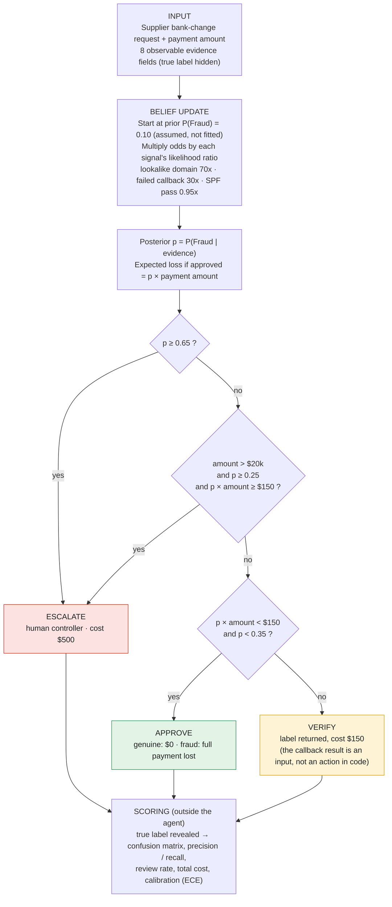
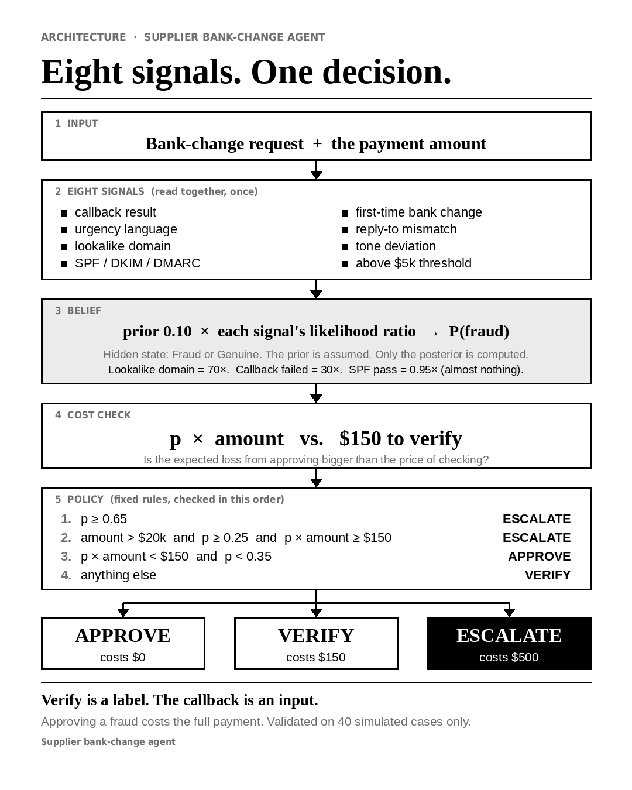

# Supplier Bank-Change Agent

A small Bayesian triage agent for supplier bank-change requests. It decides **APPROVE**, **VERIFY** or **ESCALATE** by asking one question: *is it cheaper to check, or to risk it?*

Evaluated blind against two other policies on 40 simulated cases. Everything here is simulated; costs, priors and likelihoods are stated assumptions, not measurements.

## Contents
[Problem](#problem-statement) · [Status](#status) · [Quick start](#quick-start) · [How it works](#how-it-works) · [Results](#results) · [Failure analysis](#failure-analysis) · [Limitations](#limitations) · [v2 plan](#v2-plan) · [Files](#files) · [License](#license)

## Problem statement

A supplier emails: "we've changed our bank account." Paying the new account is the fraud, and nothing in the email has to look wrong. In a compromised supplier mailbox SPF/DKIM/DMARC all pass, so the sender's identity is not the uncertain thing; intent is, and intent is never directly observable. Only weak, partly correlated signals around it are.

The costs are lopsided. A wrongly approved wire to a fraudster is lost in full (assumed unrecoverable). A wrongly flagged genuine request costs one callback or one controller review. The agent helps an accounts-payable team triage each request as:

- **APPROVE**: pay.
- **VERIFY**: a label meaning "confirm out of band before paying".
- **ESCALATE**: send to a human controller.

## Status

| Area | Status | Details |
|---|---|---|
| Agent prototype | Implemented | Cost-sensitive Bayesian policy, red-flag checklist and SPF/DKIM/DMARC baseline. |
| Evaluation | Complete (v1) | 40 simulated cases (32 genuine, 8 fraud); predictions, metrics and failure analysis in `results/`. |
| Paper | Draft complete | [Course preprint PDF](paper/main.pdf); not submitted to IJCAI. |
| Production readiness | Not ready | Simulated data; assumed costs, priors, likelihoods and thresholds. Independent validation and operational controls remain future work. |

## Quick start

Requirements: Python 3.14.3 (also reproduces on 3.10 and 3.13) and `pip install openpyxl==3.1.5` (the only dependency).

```bash
# from bank_change_agent/
python3 experiments/run_experiment.py
```

The script loads the dataset, strips `hidden_state_TRUE_LABEL` before calling each policy in `src/agent.py` (enforced in code: `evidence = {k: v ... if k != "hidden_state_TRUE_LABEL"}`), computes costs and metrics via `src/metrics.py`, and writes:

- `results/predictions.csv`: one row per case × policy (40 × 5 = 200 rows): `case_id`, `true_label`, `policy`, `action`, `p_fraud`, `flagged`, `correct`, `cost_usd`, `payment_amount_usd`.
- `results/metrics.json` and `results/metrics.md`: confusion, precision/recall/F1, FP/FN, review rates, decision costs, calibration bins + ECE.

**Verify:** `predictions.csv` has 200 rows; `metrics.json` matches the Results table; `results/failure_analysis.md` documents at least 5 named failures; `review-record.md` logs all three AI reviews.

**Re-tune (optional):** edit likelihoods or thresholds in `src/agent.py`, re-run, and compare `total_cost_usd` and `false_negatives`. Do not fit likelihoods to the test labels.

## How it works

1. **Input:** the 8 observable evidence fields plus the payment amount. The ground-truth label is stripped in code before any policy runs.
2. **Belief update:** start from prior P(Fraud) = 0.10, multiply the odds by each signal's likelihood ratio, get a posterior `p`. One step, naive Bayes. No learning, no sequential planning.
3. **Cost rule:** compare the expected loss from approving (`p × amount`) with the cost of checking ($150 VERIFY, $500 ESCALATE).
4. **Output:** one of three labels. Four rules, first match wins.



Static version of the same diagram: 

**Two points that are easy to get wrong**
- VERIFY is a label the policy returns. The agent does not make the call.
- The callback result is one of the 8 input signals, not a step inside the agent. A required field, not a mandatory call: the cost rule can still APPROVE when it is "Not Attempted" (3 of 11 such cases, all genuine).

### Evidence signals

Likelihood ratio (LR) = P(value | Fraud) / P(value | Genuine). Above 1 pushes toward fraud, below 1 toward genuine. All are assumptions, set a priori and not fitted to the test labels (`src/agent.py`).

| Signal | Value | P(v \| Fraud) | P(v \| Genuine) | LR |
|---|---|---|---|---|
| `callback_verification` | Failed | 0.60 | 0.02 | 30 |
| | Confirmed | 0.05 | 0.70 | 0.071 |
| | Not Attempted | 0.35 | 0.28 | 1.25 |
| `lookalike_domain` | Yes / No | 0.70 / 0.30 | 0.01 / 0.99 | 70 / 0.30 |
| `tone_deviation` | Yes / No | 0.50 / 0.50 | 0.08 / 0.92 | 6.25 / 0.54 |
| `first_time_bank_change` | Yes / No | 0.75 / 0.25 | 0.20 / 0.80 | 3.75 / 0.31 |
| `reply_to_mismatch` | Yes / No | 0.30 / 0.70 | 0.08 / 0.92 | 3.75 / 0.76 |
| `urgency_language` | Yes / No | 0.55 / 0.45 | 0.15 / 0.85 | 3.67 / 0.53 |
| `above_materiality_threshold_5k` | Yes / No | 0.65 / 0.35 | 0.55 / 0.45 | 1.18 / 0.78 |
| `spf_dkim_dmarc_pass` | Yes / No | 0.90 / 0.10 | 0.95 / 0.05 | 0.947 / 2.0 |

SPF/DKIM/DMARC **pass** is near-neutral (LR 0.947) because it passes on a fully compromised mailbox. It authenticates the domain, not the intent.

### Decision rules (in `src/agent.py`)

| Order | Condition | Action |
|---|---|---|
| 1 | `p ≥ 0.65` | ESCALATE |
| 2 | `amount > $20k` and `p ≥ 0.25` and `p × amount ≥ $150` | ESCALATE |
| 3 | `p × amount < $150` and `p < 0.35` | APPROVE |
| 4 | otherwise | VERIFY |

Same `p`, different action, because the money at risk differs: at p = 7.2%, a $500 payment gives an expected loss of $36 (approve), while a $5,998 payment gives $431 (verify).

### Cost model (stated assumptions, not industry facts)

| Action | Cost |
|---|---|
| APPROVE a genuine request | $0 |
| APPROVE a fraud | full `payment_amount_usd` (wire lost, unrecoverable) |
| VERIFY | $150 (callback labor + delay) |
| ESCALATE | $500 (controller review + hold/friction) |

Rationale: r/Accounting counter-signature threshold of about $5k feeds materiality; r/AI_Agents "verification costs minutes, wrong approval costs the invoice."

## Evaluation setup

**Test set:** `data/supplier_bank_change_simulated_dataset.xlsx`, sheet `Simulated_Cases`. 40 cases (30–50 required): 32 Genuine, 8 Fraud. Columns: `case_id`, `hidden_state_TRUE_LABEL` (used only for scoring), the 8 evidence fields above, and `payment_amount_usd`. **Provenance:** the 40 cases are simulated data, not real transactions. Case patterns and proportions were designed from practitioner discussions and other public sources found online (summarised in `discussion-record.md`). Proportions are directional assumptions, not measured statistics.

**Policies compared** (label hidden at decision time):

| Policy | What it does |
|---|---|
| `bayesian_cost_sensitive` (the agent) | One-step Bayesian posterior (POMDP-inspired framing, not a sequential POMDP solver) + the four expected-cost rules above. Prior 0.10, not fitted to test labels. |
| `rule_checklist` | Red-flag score: Failed callback +2, lookalike +2, first-time / urgency / reply-to / tone / amount > $5k +1 each, Not Attempted +1, SPF weight 0. Score ≥ 4 ESCALATE, 2–3 VERIFY, ≤ 1 APPROVE. |
| `baseline_spf` | APPROVE iff `spf_dkim_dmarc_pass = Yes`, else VERIFY. Tests whether email authentication alone suffices (it does not). |
| `always_approve` (reference) | Upper bound on fraud loss. Not a competing policy. |
| `always_verify` (reference) | Upper bound on review load. Not a competing policy. |

**Metrics** (accuracy is not the only one): confusion matrix, precision, recall, FP and FN counts, human-review rate ((VERIFY + ESCALATE) / N), decision cost, calibration (ECE + binned predicted vs empirical fraud rate). Flagged = VERIFY or ESCALATE. FP = genuine flagged; FN = fraud approved.

## Results

All 8 frauds flagged at $4,200 total cost and a 35% review rate. The fair comparison is `always_verify`, which also catches all 8 at $6,000 and a 100% review rate: about 30% cheaper, under assumed costs. The SPF-only baseline missed 7 of 8.

From `results/metrics.json` (reproduced on a fresh run):

| Policy | TP / FP / TN / FN | Precision | Recall | Review rate | Total cost |
|---|---|---|---|---|---|
| **bayesian_cost_sensitive** | 8 / 6 / 26 / 0 | 0.571 | 1.000 | 0.350 (8V + 6E) | **$4,200** ($0 fraud loss) |
| rule_checklist | 8 / 13 / 19 / 0 | 0.381 | 1.000 | 0.525 (12V + 9E) | $6,300 ($0 fraud loss) |
| baseline_spf | 1 / 1 / 31 / 7 | 0.500 | 0.125 | 0.050 (2V + 0E) | $143,374 ($143,074 fraud loss) |
| always_approve (ref) | 0 / 0 / 32 / 8 | 0.000 | 0.000 | 0.000 | $150,736 (all fraud lost) |
| always_verify (ref) | 8 / 32 / 0 / 0 | 0.200 | 1.000 | 1.000 (40V) | $6,000 ($0 fraud loss) |

**Calibration (ECE):** agent 0.038, checklist 0.205 (over-flags low bins), SPF baseline 0.127 (no high-confidence coverage). Bins hold n = 1–3 cases, so these are indicative only.

**Why one metric is not enough:** accuracy ranks the SPF baseline (0.80) close to the agent (0.85) and hides a $139k cost gap.

**What these results show, and what they do not** (full list in [Limitations](#limitations))
- **Shows:** on this simulated set, the cost rule flags all 8 frauds at lower cost and review load than always-verify, and email authentication alone is not enough.
- **Does not show real-world performance:** 40 simulated cases, 8 frauds. Recall 1.0 on 8 positives has an exact 95% lower bound of about 0.63.
- **Does not cover calm fraud:** every fraud here has at least 2 warning flags, so a compromised mailbox with clean signals and a confirmed callback is untested.
- **Does not validate the numbers:** costs, prior, likelihoods and thresholds are assumed and were not swept.

## Failure analysis

Six named conditions; details in `results/failure_analysis.md`. F1–F3 are frauds the SPF baseline approved and the agent flagged on other signals. F4–F6 are the agent's own false alarms. In this set the agent made no false approve (FN = 0).

| ID | Condition | Case | What happened |
|---|---|---|---|
| F1 | Stolen-callback confirmation | C034 (fraud, $54,729) | Callback was Confirmed. Baseline approved ($54,729 loss); agent escalated on the other flags. |
| F2 | Urgency-free sleeper | C009 (fraud, $56,875) | Calm fraud with no urgency language. Baseline approved; agent escalated (first-time + lookalike + failed callback). |
| F3 | Repeat-vendor camouflage | C002 (fraud, $8,814) | `first_time = No` did not clear it. Baseline approved; agent flagged on lookalike + tone + urgency. |
| F4 | Stale-contact false alarm | C020 (genuine, $5,998) | Callback Failed on a stale number; agent VERIFY, $150 wasted. |
| F5 | Legitimate-urgency over-triage | C026 (genuine, $37,528) | Real deadline plus large amount; agent VERIFY ($150), checklist ESCALATE ($500). |
| F6 | Benign anomaly coincidence | C014 (genuine, $17,322) | Reply-to drift and tone shift with an innocent cause; agent VERIFY, $150. |

Highest-cost error: **false approve of fraud** (FN), $3k–$57k irreversible loss per miss in this set, versus $150–$500 per false alarm. Wires are unrecoverable; delays are resolved by one callback.

## Limitations

IDs such as PR1, PB6 and PP3 are comments from the three AI reviews logged in `review-record.md` (PR = practitioner lens, PB = probability lens, PP = preprint lens; e.g. PB1 = prior vs prevalence). Read before treating any number as more than a demo.

**Data and validity**
- **Simulated, single split (PP4, PP5):** 40 cases, no holdout or replication; results could be demo-luck. Amounts must never be quoted as real fraud data.
- **No clean-looking fraud:** every fraud in the test set has at least 2 warning flags (lowest: C030, C039). There is no false-negative case, so the zero-FN result shows the agent handles *noisy* fraud, not *calm* fraud.

**Assumptions**
- **Costs not measured (PR1/PB6):** VERIFY = $150, ESCALATE = $500, fraud loss = full amount (zero recovery). Re-tune from local labor rates and use loss = amount × (1 − recovery rate); hold cost should scale with amount/terms (PR5).
- **Prior vs prevalence (PB1):** prior 0.10 is a priori; test prevalence is 0.20. ECE is conditional on this gap.
- **Invented likelihoods + independence (PB2/PB3):** all LRs are directional assumptions. Naive Bayes double-counts correlated pairs (first-time + urgency, lookalike + tone). The auth signal is also one LR regardless of *which* domain passed (see v2).
- **Hand-picked thresholds (PB5):** 0.35 / 0.65 and the $20k guard were not swept.
- **Small-n calibration (PB7):** ECE bins hold 1–3 cases.

**Method**
- **One-step, not sequential (PP3):** no POMDP solver or value iteration; claims are worded as POMDP-inspired.
- **Callback is cost-driven, not mandatory:** the practitioner discussion in `discussion-record.md` favoured an unconditional callback for any bank-detail change; v1 does not implement that. Making it mandatory would cost at least $150 per case, which is `always_verify` territory ($6,000 here).

**Deployment**
- **Capacity (PR4):** 35–52% review rates exceed realistic human budgets (about 10 deep reviews per week) and risk rubber-stamping. Thresholds must be set downstream of a stated capacity budget.
- **Stale master data (PR3):** the "known number" is trusted but never verified (see F1/F4). Number changes need a separate authorization path.
- **Missing stakeholders (PR2):** supplier (delay harm), bank (recall window), auditor (segregation evidence). Per-decision audit fields are specified in `decisions/probability-decision-record.md` §6.

## v2 plan

Planned, **not implemented**. v1 numbers above do not include any of this.

**Signals**
- [ ] **Split the authentication signal** (from practitioner feedback citing RFC 9989: a DMARC pass only means the Author Domain's use was authorised). Replace `spf_dkim_dmarc_pass` with `auth_result` = `pass_domain_of_record` / `pass_other_domain` / `fail`, checked against the domain on the vendor master record. A pass on another domain should push toward fraud; a pass on the domain of record rules out spoofing and lookalikes but cannot separate genuine from compromised-mailbox. Likelihoods remain assumptions.
- [ ] **Harden the callback signal:** only call numbers that were on file before the request, and add a signal for recent contact-detail changes (addresses F1 and F4). A Confirmed callback cannot tell a stolen phone from an insider.
- [ ] **Decide callback policy:** keep cost-driven (current) or make the call mandatory for any bank-detail change and use the model to rank the queue and set escalation.

**Evaluation**
- [ ] **Add calm-fraud cases:** compromised mailbox where everything passes and the callback confirms, including at least one false-negative case.
- [ ] **Run the sensitivity checks listed above:** prior sweep (0.05 / 0.20), ±50% LR perturbation (e.g. Failed-callback 30 → 15), and a threshold sweep on a separate validation split against total cost. Confirm the zero-FN result survives, or report where it breaks.
- [ ] **Larger, separate holdout** so results are not tuned and tested on the same cases.

**Modelling**
- [ ] **Model correlated signals** instead of multiplying them independently (PB2).

## Files

| Path | Purpose |
|---|---|
| `src/agent.py` | Likelihoods, posterior, the three policies |
| `src/metrics.py` | Confusion, cost, calibration |
| `experiments/run_experiment.py` | Runs all policies, writes results |
| `data/supplier_bank_change_simulated_dataset.xlsx` | 40 simulated cases |
| `results/` | `predictions.csv`, `metrics.json`, `metrics.md`, `failure_analysis.md`, `architecture_diagram.png` |
| `decisions/probability-decision-record.md` | Decision record, audit fields (§6) |
| `review-record.md` | Three AI reviews behind the limitation IDs |
| `discussion-record.md` | Practitioner discussions used to design the cases, costs and likelihoods |
| `research-file.md` | Research notes |
| `paper/` | Course preprint |
| `social/` | Links to public posts |

## License

Apache License 2.0. See [LICENSE](LICENSE).
